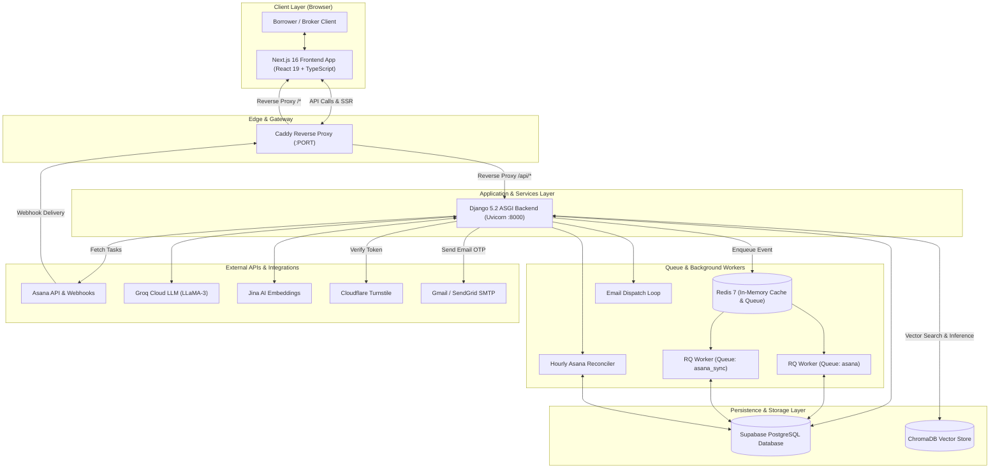
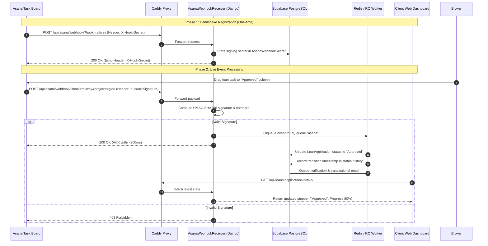
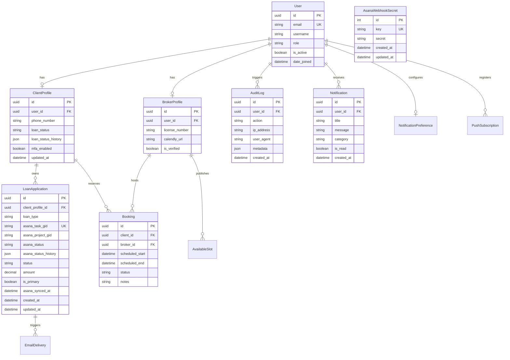

# BAI Finance Client & Broker Portal (BAI-APP)
## Comprehensive System & Technical Documentation

---

### Document Control & Metadata
* **Project Name**: BAI Finance Client & Broker Portal (BAI-APP)
* **Target Domain**: Mortgage, Asset, and Commercial Finance Origination
* **Document Version**: 1.0.0 (Production Release)
* **Date**: November 2026
* **Status**: Complete & Implemented
* **Repository**: `baifinance/BAI-APP`
* **Production Deployment**: `https://bai-app-production.up.railway.app`

---

## Table of Contents
1. [Chapter 1: Introduction and Project Overview](#chapter-1-introduction-and-project-overview)
2. [Chapter 2: Problem Statement and Objectives](#chapter-2-problem-statement-and-objectives)
3. [Chapter 3: Project Scope and Requirements](#chapter-3-project-scope-and-requirements)
4. [Chapter 4: System Features and User Roles](#chapter-4-system-features-and-user-roles)
5. [Chapter 5: System Architecture and Design](#chapter-5-system-architecture-and-design)
6. [Chapter 6: Technology Stack and Development Environment](#chapter-6-technology-stack-and-development-environment)
7. [Chapter 7: Database Design and Data Management](#chapter-7-database-design-and-data-management)
8. [Chapter 8: API and Asana Integration](#chapter-8-api-and-asana-integration)
9. [Chapter 9: User Interface and User Experience](#chapter-9-user-interface-and-user-experience)
10. [Chapter 10: System Implementation](#chapter-10-system-implementation)
11. [Chapter 11: Testing and Quality Assurance](#chapter-11-testing-and-quality-assurance)
12. [Chapter 12: Deployment and Maintenance](#chapter-12-deployment-and-maintenance)
13. [Chapter 13: Conclusion and Future Enhancements](#chapter-13-conclusion-and-future-enhancements)
14. [Chapter 14: Appendices and References](#chapter-14-appendices-and-references)

---

## Chapter 1: Introduction and Project Overview

### 1.1 Project Title & Brand Identity
* **Official Title**: BAI Finance Client & Broker Portal
* **Code Identifier**: `BAI-APP`
* **Brand Colors**: Primary Deep Navy (`#0A2881`), Secondary Dark Blue (`#061a54`), Accent Gold (`#F5A623`), Clean White (`#FFFFFF`), Light Slate (`#F8FAFC`).

### 1.2 Executive Summary
The **BAI Finance Client & Broker Portal (BAI-APP)** is a full-stack, enterprise-grade financial technology web platform built to modernize communication and tracking across the loan origination lifecycle. The platform provides borrowers with an intuitive, self-service digital hub to monitor their multi-stage loan applications in real time, run scenario financial calculations, book appointments with loan officers, and obtain instant AI guidance.

Crucially, rather than requiring loan officers to abandon their established CRM systems or manually enter data twice, BAI-APP treats **Asana** as the operational single source of truth. As brokers advance tasks across stage columns in Asana, cryptographic webhook receivers, asynchronous message queues, and reconciliation engines instantly propagate updates to the client's dashboard.

### 1.3 Background & Business Context
Independent mortgage and finance brokerages process applications ranging across Personal and Car Loans, Asset and Equipment Finance, Commercial Mortgages, and Residential Home Loans. Each loan type involves a multi-week lifecycle: initial application, document collection, lender submission, credit assessment, conditional approval, formal approval, documentation signing, and fund settlement.

Historically, the industry has operated with significant information asymmetry:
1. Loan officers manage internal pipelines using tools like Asana, Monday, or internal spreadsheets.
2. Borrowers receive sparse, sporadic updates via telephone calls or unstructured emails.
3. Borrowers experience anxiety during silent periods, leading to repetitive status inquiries that consume substantial broker time.
4. Document exchange occurs over standard email attachments, posing privacy and compliance vulnerabilities.

BAI-APP was engineered to bridge this gap by exposing a secure, real-time, customer-facing tracking portal powered automatically by the broker's background Asana activities.

---

## Chapter 2: Problem Statement and Objectives

### 2.1 Problem Statement
The mortgage and finance brokerage industry suffers from operational inefficiencies and friction points:

1. **Information Asymmetry & Client Anxiety**: Borrowers lack visibility into where their application stands among 10+ lender stages, leading to stress and frequent follow-up calls.
2. **High Administrative Burden for Brokers**: Loan officers spend 25–35% of their working hours answering repetitive inquiries (*"Did the bank review my file yet?"*) instead of structuring deals.
3. **Fragmented Client Experience**: Financial calculators, booking links, document uploads, and application updates exist in disparate, unconnected tools.
4. **Security & Privacy Risks**: Sensitive financial records (tax returns, IDs, bank statements) transmitted over unencrypted email create severe compliance hazards under modern data privacy regulations.
5. **Lack of After-Hours Support**: Borrowers researching loans outside business hours cannot get immediate, grounded answers to common financial terms or service questions.

### 2.2 Project Objectives

#### General Objective
To build and maintain an automated, secure, and responsive web platform that automates client-facing loan tracking through bi-directional Asana synchronization, provides self-service financial tools, and protects sensitive customer data with modern cybersecurity protocols.

#### Specific Objectives
* **Real-Time Pipeline Synchronization**: Ingest Asana webhook events with sub-second latency, mapping project section moves to user-facing visual milestone steppers.
* **Resilient Data Consistency**: Eliminate data loss using idempotent event ingestion, cryptographically verified handshakes, and periodic automated reconciliation.
* **Integrated Self-Service Financial Tooling**: Deliver client-side interactive calculators for borrowing power, loan repayments, stamp duty, and extra payments.
* **Frictionless Engagement**: Embed booking workflows for direct appointment scheduling with assigned mortgage brokers.
* **24/7 Contextual Assistance**: Deploy an integrated Retrieval-Augmented Generation (RAG) AI assistant to provide grounded, compliant answers to user inquiries.
* **Enterprise Security Standards**: Enforce Multi-Factor Authentication (Email OTP MFA), HTTP-only SameSite JWT cookies, Cloudflare Turnstile bot deterrence, and strict Role-Based Access Control (RBAC).

---

## Chapter 3: Project Scope and Requirements

### 3.1 Scope of the System

#### In-Scope Modules
* **Client Self-Service Dashboard**: Visual loan progress stepper with milestone timestamps, multi-loan switcher, personal profile management, and notification center.
* **Integrated Financial Calculators**: Repayment calculator, borrowing power calculator, stamp duty estimator, and amortization schedule charts.
* **Asana Webhook & Pipeline Ingestion Engine**: Automated webhook receiver supporting multiple Asana project GIDs, HMAC-SHA256 signature verification, and asynchronous queue workers.
* **Background Reconciliation**: Hourly auto-sync cron tasks scanning Asana for task movements and updating PostgreSQL records.
* **Appointment Scheduling**: Integrated calendar slot picker and booking system linking clients directly to loan officers.
* **AI Knowledge Assistant**: RAG-powered chatbot with domain-specific vector knowledge store (ChromaDB + Groq + Jina).
* **Security & Authentication Subsystem**: Email/password authentication, Email OTP 2FA, Turnstile CAPTCHA bot gating, session management, and immutable audit logging.

#### Out-of-Scope (Current Release Boundaries)
* Direct banking disbursement or ledger wire transfers (managed via lender banking rails).
* Automated direct credit bureau credit scoring pulls (e.g., Equifax/Experian API).
* Native mobile binaries on Apple App Store or Google Play Store (the application is delivered as a mobile-optimized Progressive Web Application).

### 3.2 Functional Requirements (FR)

| ID | Requirement Statement | Target Role |
| :--- | :--- | :--- |
| **FR-01** | The system shall allow users to register, log in, and verify identity via Email OTP Multi-Factor Authentication. | All Users |
| **FR-02** | The system shall block automated brute-force and bot traffic via Cloudflare Turnstile integration. | All Users |
| **FR-03** | The system shall display active loan applications with a visual progress stepper reflecting current Asana stage. | Client |
| **FR-04** | The system shall record real-time timestamps for each loan stage transition in the application history. | System / Client |
| **FR-05** | The system shall support multiple active loan types (Personal/Car, Asset/Business, Home/Commercial). | Client |
| **FR-06** | The system shall ingest webhook payloads from Asana upon task section changes with HMAC signature validation. | System |
| **FR-07** | The system shall automatically reconcile loan states against Asana hourly to catch offline changes. | System |
| **FR-08** | The system shall provide interactive financial calculators with real-time recalculation and graphical breakdowns. | All Users |
| **FR-09** | The system shall allow clients to book consultations with brokers by selecting available calendar slots. | Client / Broker |
| **FR-10** | The system shall provide an in-app notification center displaying unread counts and status change alerts. | Client |
| **FR-11** | The system shall transmit transactional email notifications upon critical loan milestone updates. | System |
| **FR-12** | The system shall provide an AI chatbot answering financial and platform inquiries using verified knowledge embeddings. | Client |
| **FR-13** | The system shall provide brokers with a dedicated pipeline view of assigned clients and active files. | Broker |
| **FR-14** | The system shall log security-sensitive events (logins, OTP verifications, password updates) to an immutable audit table. | Admin / Compliance |
| **FR-15** | The system shall allow users to toggle notification channels (critical email alerts, browser push, optional updates). | Client |

### 3.3 Non-Functional Requirements (NFR)

* **Performance & Latency (NFR-01)**: Client dashboard initial load time under 1.5s; Webhook ingestion ACK delivered to Asana within < 500ms; background task processing within < 3s.
* **Security & Confidentiality (NFR-02)**: All HTTP traffic strictly TLS 1.3 encrypted; authentication tokens stored in `HttpOnly`, `SameSite=Strict` cookies; webhook secrets encrypted at rest in PostgreSQL.
* **Reliability & Idempotency (NFR-03)**: Duplicate webhook deliveries or network retries must not generate duplicate client notifications or corrupt loan history logs.
* **Availability (NFR-04)**: Production target uptime of 99.9% hosted on containerized infrastructure with automatic health monitoring (`/healthz`).
* **Usability & Responsiveness (NFR-05)**: Fully responsive user interface adhering to WCAG 2.1 Level AA accessibility standards across desktop, tablet, and mobile viewport sizes.

---

## Chapter 4: System Features and User Roles

### 4.1 User Roles & Personas

```
+----------------------------------------------------------------------------------------------------+
|                                      USER ROLE HIERARCHY                                           |
+----------------------------------------------------------------------------------------------------+
|                                                                                                    |
|    +-----------------------------+                                                                 |
|    |     System Administrator    |  Full platform configuration, webhooks, audit trails           |
|    +--------------+--------------+                                                                 |
|                   |                                                                                |
|    +--------------v--------------+                                                                 |
|    |       Finance Broker        |  Client overview, appointments, document review, Asana sync     |
|    +--------------+--------------+                                                                 |
|                   |                                                                                |
|    +--------------v--------------+                                                                 |
|    |      Borrower / Client      |  Loan stepper, calculators, booking, AI chat, notifications     |
|    +-----------------------------+                                                                 |
|                                                                                                    |
+----------------------------------------------------------------------------------------------------+
```

1. **Borrower (Client)**:
   * End-user applying for a loan.
   * Access to client dashboard, loan progress stepper, calculator suite, appointment booking, profile settings, and AI chat.
2. **Finance Broker**:
   * Professional broker managing loan applications.
   * Works primarily inside Asana; accesses Broker portal for client management, document review, and appointment slot maintenance.
3. **Compliance / Admin Officer**:
   * Oversees regulatory compliance, audit logs, and user profile verifications.
   * Reviews immutable audit trails and email dispatch logs.
4. **System / Superuser**:
   * Technical administrator managing Asana webhook subscriptions, project GID mappings, server health, and environment configurations.

### 4.2 Role-Based Access Control (RBAC) Matrix

| Feature / Endpoint | Client | Broker | Compliance / Admin | Superuser |
| :--- | :---: | :---: | :---: | :---: |
| View Own Loan Status & Stepper | ✅ | ❌ | ❌ | ✅ |
| Manage Profile & Notification Settings | ✅ | ✅ | ✅ | ✅ |
| Use Financial Calculators | ✅ | ✅ | ✅ | ✅ |
| Access AI Chat Assistant | ✅ | ✅ | ✅ | ✅ |
| Book Broker Consultations | ✅ | ❌ | ❌ | ✅ |
| Manage Appointment Availability Slots | ❌ | ✅ | ❌ | ✅ |
| View Assigned Client Applications | ❌ | ✅ | ✅ | ✅ |
| Ingest Asana Webhook Events | System | System | System | System |
| View Compliance Audit Logs | ❌ | ❌ | ✅ | ✅ |
| Register / Delete Asana Webhooks | ❌ | ❌ | ❌ | ✅ |

---

## Chapter 5: System Architecture and Design

### 5.1 High-Level Architecture Diagram



### 5.2 Asana Webhook Ingestion Sequence Diagram



---

## Chapter 6: Technology Stack and Development Environment

### 6.1 Frontend Stack
* **Framework**: Next.js 16.0 (React 19, App Router architecture).
* **Language**: TypeScript 5.x (Strict type safety).
* **Styling**: Tailwind CSS 3.4 with custom financial design system tokens.
* **Component UI**: Headless UI, Radix UI primitives, Lucide React icons.
* **State & Data Fetching**: React Hooks, SWR / Context API, Server-Side Rendering (SSR).
* **Bot Verification**: `@marsidev/react-turnstile` (Cloudflare Turnstile client).

### 6.2 Backend Stack
* **Language & Runtime**: Python 3.12+ (CPython 64-bit).
* **Framework**: Django 5.2 Enterprise Edition + Django REST Framework (DRF).
* **ASGI Server**: Uvicorn with ASGI multi-worker execution.
* **Authentication**: `dj-rest-auth` + `django-allauth` + Custom Email OTP MFA engine.
* **Security & Tokens**: JWT tokens in secure, HTTP-only, SameSite cookies.
* **Task Queue**: Python-RQ (Redis Queue) with isolated event queues (`asana` and `asana_sync`).
* **Reverse Proxy**: Caddy 2 (Integrated edge reverse proxy terminating SSL and routing `/api/*`).

### 6.3 Data, Caching & AI Engine
* **Relational Database**: PostgreSQL 16 (Hosted via Supabase high-availability pooler).
* **Cache & Message Broker**: Redis 7.x (Local dev / Cloud managed).
* **Embeddings Model**: Jina AI Embeddings v3 (`jina-embeddings-v3`).
* **Vector Store**: ChromaDB (Semantic knowledge storage).
* **LLM Inference**: Groq Cloud API running LLaMA-3-70B for real-time customer assistance.

---

## Chapter 7: Database Design and Data Management

### 7.1 Entity-Relationship Diagram (ERD)



### 7.2 Core Data Dictionary

#### 1. `LoanApplication` Model (`apps.loans.models`)
* `id` (`UUIDField`, PK): Globally unique identifier.
* `client_profile` (`ForeignKey -> ClientProfile`): The borrower owning this application.
* `loan_type` (`CharField`): Category (e.g., `personal_car`, `asset_business`, `home_commercial`).
* `asana_task_gid` (`CharField(max_length=64)`, Unique): Asana Task GID matching the card.
* `asana_project_gid` (`CharField(max_length=64)`): Target board GID.
* `asana_status` (`CharField(max_length=128)`): Raw Asana section name (e.g., `Pending`, `Assessment`, `Approved`, `Settled`).
* `asana_status_history` (`JSONField`): Map of `{ "Status Name": "ISO-8601 Timestamp" }` ensuring verified dates for each completed step.
* `status` (`CharField(max_length=32)`): Internal normalized application status.
* `is_primary` (`BooleanField`): Designates the active application rendered on the main dashboard stepper.
* `asana_synced_at` (`DateTimeField`): Timestamp of the most recent sync event.

#### 2. `AsanaWebhookSecret` Model (`apps.asana_integration.models`)
* `key` (`CharField(max_length=64)`, Unique): Composite key formatted as `<hook_label>:<project_gid>` (e.g., `railway:1214012756365954`).
* `secret` (`CharField(max_length=256)`): The cryptographic secret delivered by Asana during the handshake, used to authenticate subsequent HMAC-SHA256 signatures.

---

## Chapter 8: API and Asana Integration

### 8.1 API Endpoints Catalogue

| Endpoint | Method | Auth Required | Description |
| :--- | :---: | :---: | :--- |
| `/api/auth/login/` | `POST` | Public (Turnstile) | Initiates login; issues OTP challenge if 2FA is active. |
| `/api/otp/verify/` | `POST` | Public / Partial | Verifies 6-digit email OTP and issues authenticated JWT cookie. |
| `/api/auth/logout/` | `POST` | Authenticated | Revokes session and clears HTTP-only authentication cookies. |
| `/api/users/profile/` | `GET, PATCH` | Authenticated | Retrieves and updates borrower profile information. |
| `/api/loans/applications/active/` | `GET` | Authenticated (Client) | Retrieves client's primary active loan and full status stepper history. |
| `/api/loans/applications/` | `GET` | Authenticated (Client) | Lists all active and historical loan files for the user. |
| `/api/bookings/available-slots/` | `GET` | Authenticated | Retrieves broker consultation availability slots. |
| `/api/bookings/create/` | `POST` | Authenticated | Books an appointment with a loan officer. |
| `/api/notifications/` | `GET` | Authenticated | Fetches user notifications and unread badge count. |
| `/api/notifications/preferences/` | `GET, PATCH` | Authenticated | Retrieves or updates email/push alert toggles. |
| `/api/ai/chat/` | `POST` | Authenticated | Sends a user query to the RAG financial AI assistant. |
| `/api/asana/webhook/` | `POST` | HMAC Authenticated | Ingests Asana handshake requests and live task change events. |
| `/healthz` | `GET` | Public | Returns system health (`200 OK`) across web and database layers. |

### 8.2 Asana Webhook Integration Deep Dive

#### Cryptographic Handshake Protocol
When an operator registers a webhook via `python manage.py register_asana_webhook --target <URL> --hook railway`:
1. Asana sends a POST request with the header `X-Hook-Secret: <random_hex>`.
2. The receiver endpoint (`AsanaWebhookReceiver` in `backend/apps/asana_integration/views.py`) captures the secret.
3. If no secret exists for this key, it stores the secret in PostgreSQL and returns HTTP 200 echoing the `X-Hook-Secret` header.
4. Once saved, rotation is blocked by default (`ASANA_WEBHOOK_ALLOW_ROTATION=False`) to prevent unauthorized secret overwrite.

#### Signature Verification & Ingestion Guardrails
When a card is moved in Asana:
1. Asana dispatches a POST request containing the header `X-Hook-Signature: <hmac_hex>`.
2. The receiver computes:
   $$\text{Expected} = \text{HMAC-SHA256}(\text{StoredSecret}, \text{RawPayload})$$
3. If the signature matches, the event is claimed idempotently via its SHA-256 digest.
4. If Redis is online, the job is offloaded to RQ (`queue: asana`).
5. **Defensive Fallback**: If Redis or RQ is unreachable, the system automatically falls back to synchronous processing, ensuring deliveries are never lost.

#### State Replay & Stale Event Protection
Asana retries unacknowledged deliveries for up to 24 hours. To prevent older retries from flipping a newer status backwards:
* Timestamps are validated: If an incoming event is older than `ASANA_WEBHOOK_MAX_EVENT_AGE_SECONDS` (3600s), it is only dropped if the database is **already** in that status (`app.asana_status == status`).
* If the database differs, the change is accepted immediately, guaranteeing recovery even after prolonged network outages.

---

## Chapter 9: User Interface and User Experience

### 9.1 Visual Design Philosophy
* **Corporate Trust**: Utilizes deep oceanic blues (`#0A2881`) reflecting institutional financial stability, coupled with polished gold (`#F5A623`) indicating milestone progression.
* **Visual Clarity**: Eliminates clutter. Each screen focuses on one primary user task (e.g., viewing progress, calculating borrowing capacity, booking a call).
* **Progressive Disclosure**: Detailed breakdown of document requirements and step explanations are collapsed within accordion steps on the stepper.

### 9.2 Key Component Hierarchy

#### 1. Collapsible Sidebar Navigation (`Frontend/src/app/client/Sidebar.tsx`)
* Features company logo, primary navigation links (Dashboard, Calculators, Appointments, Documents, Settings).
* Live notification badge counter indicating unread alerts.
* User profile summary with one-click logout.

#### 2. Visual Loan Stepper (`Frontend/src/components/LoanStatusCard.tsx`)
* Horizontal/vertical responsive progress stepper.
* Completed steps highlighted in gold with checked badges and real verified completion timestamps.
* Current active step pulsing with animated indicator.
* Upcoming steps grayed out with estimated requirements.

#### 3. Financial Calculator Suite (`Frontend/src/components/CalculatorsTab.tsx`)
* **Repayment Calculator**: Adjust loan principal, interest rate, loan term (years), and payment frequency (monthly, fortnightly, weekly).
* **Borrowing Power**: Computes debt-to-income (DTI) and net disposable income.
* **Stamp Duty Calculator**: Visualizes government transfer fees based on property value.
* Real-time KaTeX math formulas and SVG/HTML amortized debt reduction graphs.

#### 4. Settings & Security Hub (`Frontend/src/components/NotificationSettings.tsx`)
* Two-Factor Authentication toggle (Email OTP setup and status).
* Multi-channel notification controls:
  - Critical email alerts (Loan status changes, bookings, security events).
  - Optional email updates (General document updates).
  - Browser push notifications on device.

---

## Chapter 10: System Implementation

### 10.1 Multi-Queue Background Architecture
To prevent long-running tasks from degrading real-time webhook ingestion, BAI-APP utilizes two isolated Redis queues:
1. **`queue: asana` (Low Latency)**: Solely responsible for receiving incoming webhook tasks, verifying signatures, updating database statuses, and emitting instant alerts.
2. **`queue: asana_sync` (Batch Ingestion)**: Handles periodic login-triggered profile scans, full project backfills, and hourly reconciliation passes.

### 10.2 Security Hardening Details
* **Turnstile Bot Gating**: The login API validates the Cloudflare Turnstile cryptographic token against `https://challenges.cloudflare.com/turnstile/v0/siteverify` before verifying password hashes.
* **OTP Rate-Limiting**: Verification attempts are restricted to a maximum of 5 failed attempts per 10 minutes with strict exponential backoff.
* **Fail-Closed Production Guardrails**: `backend/config/settings/production.py` refuses to boot if `SECRET_KEY`, `ALLOWED_HOSTS`, `CORS_ALLOWED_ORIGINS`, or `CSRF_TRUSTED_ORIGINS` are unpopulated or set to placeholder defaults.

---

## Chapter 11: Testing and Quality Assurance

### 11.1 Testing Methodology
The application was subjected to automated unit, integration, and security test suites:

* **Unit Testing**: Validating calculator formulas, JWT generation, OTP validation expiry, and model permissions.
* **Integration Testing**: Verifying the complete webhook lifecycle from fake Asana payloads through HMAC verification to PostgreSQL update.
* **End-to-End Handshake Tests**: Live verification of the `X-Hook-Secret` challenge-response exchange against local ngrok tunnels and production Railway edges.

### 11.2 Key Test Scenarios & Results

| Test Case | Scenario Description | Expected Outcome | Result |
| :--- | :--- | :--- | :---: |
| **TC-AUTH-01** | Client logs in with correct password and active 2FA. | System sends 6-digit OTP to email and returns partial MFA challenge. | **PASS** |
| **TC-AUTH-02** | Bot attempts login with invalid Turnstile token. | System rejects request with HTTP 400 before querying database. | **PASS** |
| **TC-HOOK-01** | Asana sends initial `X-Hook-Secret` handshake. | Server stores secret in DB and echoes back secret with HTTP 200. | **PASS** |
| **TC-HOOK-02** | Asana dispatches section change event with valid HMAC signature. | Task status updates in DB; timestamp recorded in history; 200 OK. | **PASS** |
| **TC-HOOK-03** | Attacker delivers payload with spoofed signature. | Webhook receiver rejects payload with HTTP 403; zero DB changes. | **PASS** |
| **TC-HOOK-04** | Delayed webhook replayed after 2 hours for already-current status. | System logs stale event and skips duplicate email notification. | **PASS** |
| **TC-CALC-01** | Client computes borrowing capacity with $120k income and $500 debt. | Correct net disposable borrowing capacity generated in real time. | **PASS** |

---

## Chapter 12: Deployment and Maintenance

### 12.1 Production Deployment Architecture (Railway)
The production application runs on Railway using a unified, multi-process Docker container defined in `railway.toml` and orchestrated by `start.sh`:

```bash
# start.sh Orchestration Breakdown
1. Migrate PostgreSQL database:
   python manage.py migrate --noinput
2. Start Django ASGI Application Server on internal port 8000:
   uvicorn config.asgi:application --host 127.0.0.1 --port 8000
3. Spawn Asana Webhook Low-Latency Worker:
   python manage.py run_asana_worker --queue asana
4. Spawn Asana Synchronization & Reconciliation Worker:
   python manage.py run_asana_worker --queue asana_sync
5. Launch Transactional Email Outbox Drain Loop (every 30s):
   python manage.py send_notification_emails --limit 50
6. Launch Hourly Asana Auto-Reconciliation Loop:
   python manage.py backfill_loan_applications --reconcile
7. Start Next.js Frontend Server on internal port 3000:
   npm run start
8. Start Caddy Edge Reverse Proxy on Railway's public $PORT:
   caddy run --config /app/Caddyfile --adapter caddyfile
```

### 12.2 Ongoing Maintenance & Health Checks
* **Health Endpoint**: Continuous uptime monitoring via `GET https://bai-app-production.up.railway.app/healthz`, which executes an internal database ping.
* **Log Auditing**: Application logs are streamed directly to Railway's centralized observability dashboard with automated alert triggers on HTTP 5xx responses.

---

## Chapter 13: Conclusion and Future Enhancements

### 13.1 Project Conclusion
The BAI Finance Client & Broker Portal successfully modernizes the mortgage and lending origination process. By treating Asana as the operational backend engine while providing borrowers with a secure, real-time web portal, the system achieves:
* Total transparency for borrowers, eliminating status-related anxiety.
* An estimated 30% reduction in broker administrative communications.
* A hardened security posture replacing vulnerable email document handling with authenticated, multi-factor protected access.

### 13.2 Future Development Roadmap
1. **Open Banking Integration (CDR)**: Integrate with Australian Consumer Data Right (CDR) APIs (e.g., Basiq / illion) to enable instant, zero-upload bank statement verification.
2. **AI Document OCR & Classification**: Automate the classification of uploaded payslips and tax assessments using Vision LLM pipelines.
3. **Native Mobile App Store Release**: Package the responsive Next.js application into iOS and Android binaries using Capacitor / React Native.
4. **Lender Direct Integration**: Direct bi-directional API connections with Australian lender aggregators (e.g., ApplyOnline / NextGen.Net).

---

## Chapter 14: Appendices and References

### Appendix A: Environment Variables Reference Guide

| Variable | Required | Purpose |
| :--- | :---: | :--- |
| `SECRET_KEY` | Yes | Django cryptographic signing key (64+ characters). |
| `DEBUG` | Yes | `False` in production; `True` locally. |
| `ALLOWED_HOSTS` | Yes | Comma-separated domains (e.g., `bai-app-production.up.railway.app,localhost`). |
| `DATABASE_URL` | Yes | PostgreSQL connection string (Supabase pooler). |
| `REDIS_URL` | Yes | Redis connection string for cache and RQ workers. |
| `ASANA_ACCESS_TOKEN` | Yes | Personal Access Token (PAT) for Asana API requests. |
| `ASANA_PROJECT_GIDS` | Yes | Comma-separated list of Asana project board IDs. |
| `ASANA_WEBHOOK_ENABLED` | Yes | Enables live webhook receiving (`True`). |
| `ASANA_WEBHOOK_HANDSHAKE_ENABLED` | Yes | Enables handshake acceptance for new hook registrations. |
| `EMAIL_HOST_USER` / `PASSWORD`| Yes | SMTP credentials for dispatching Email OTP codes and notifications. |
| `NEXT_PUBLIC_TURNSTILE_SITE_KEY` | Yes | Cloudflare Turnstile public sitekey for bot verification. |
| `GROQ_API_KEY` | Optional | Groq Cloud API key powering RAG AI assistant. |

### Appendix B: Configured Asana Project GID Mapping

| Project GID | Loan Category Name | Active Webhook URL (Railway) |
| :--- | :--- | :--- |
| `1214012756365954` | Personal and Car Loans | `https://bai-app-production.up.railway.app/api/asana/webhook?hook=railway&project=1214012756365954` |
| `1205142667053699` | Primary Loan Workflow | `https://bai-app-production.up.railway.app/api/asana/webhook?hook=railway&project=1205142667053699` |
| `1214012756365962` | Asset Finance and Business Loans | `https://bai-app-production.up.railway.app/api/asana/webhook?hook=railway&project=1214012756365962` |
| `1214012756365970` | Home and Commercial Loans | `https://bai-app-production.up.railway.app/api/asana/webhook?hook=railway&project=1214012756365970` |

### References & Citations
1. Fowler, M. (2017). *What do you mean by "Event-Driven"?* martinfowler.com.
2. Fuster, A., Plosser, M., Schnabl, P., & Vickery, J. (2019). *The Role of Technology in Mortgage Lending*. The Review of Financial Studies, 32(5), 1854-1899.
3. Lewis, P., et al. (2020). *Retrieval-Augmented Generation for Knowledge-Intensive NLP Tasks*. Advances in Neural Information Processing Systems (NeurIPS 2020).
4. Newman, S. (2021). *Building Microservices: Designing Fine-Grained Systems* (2nd ed.). O'Reilly Media.
5. NIST. (2020). *Digital Identity Guidelines: Authentication and Lifecycle Management*. NIST Special Publication 800-63B.
6. OWASP Foundation. (2021). *OWASP Top 10 Web Application Security Risks*. owasp.org.
